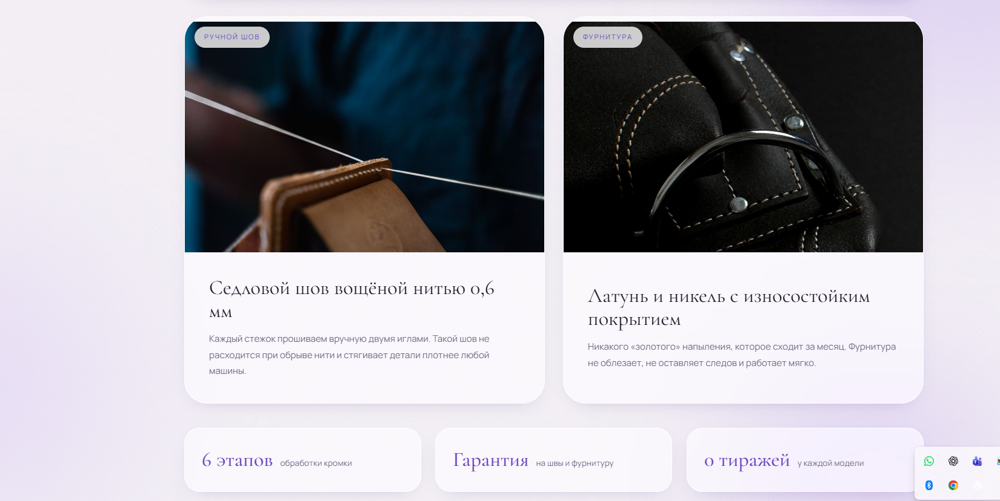
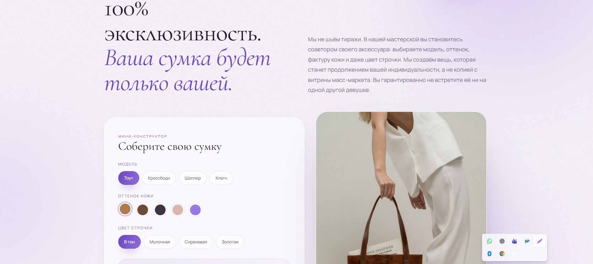
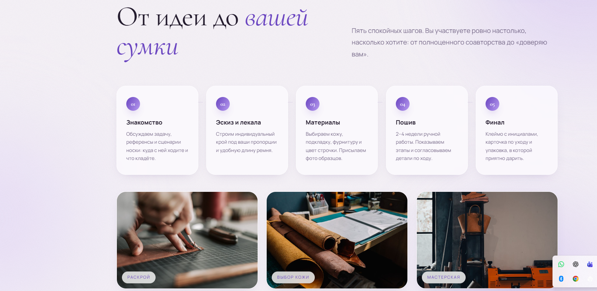

<h1 align="center">👜 LILA — мастерская кожаных сумок</h1>

<strong>Лендинг индивидуального пошива сумок и аксессуаров из натуральной кожи.</strong>

---

## О проекте

**LILA** — одностраничный сайт мастерской из Санкт-Петербурга. Он знакомит посетителя с индивидуальным пошивом, показывает материалы и примеры изделий, объясняет этапы работы и предлагает оставить заявку на обсуждение заказа.

Сайт написан на HTML, CSS и JavaScript. Фотографии и шрифты находятся в проекте, сборщик и установка зависимостей для просмотра страницы не требуются.

## 🎯 Решаемая задача

При заказе сумки ручной работы покупателю важно увидеть качество исполнения, понять возможности персонализации и узнать, как проходит работа с мастером. Лендинг последовательно отвечает на эти вопросы и приводит к форме заявки.

Для мастерской сайт служит витриной работ и каналом обращения новых клиентов. Заявки передаются в Google Таблицу, где можно увидеть контакт, пожелания и источник обращения.

## 👤 Пользователи

| Пользователь | Что получает |
| --- | --- |
| **Покупатель сумки или аксессуара** | Изучает примеры, материалы и этапы пошива, выбирает предпочтения и оставляет контакт для обсуждения. |
| **Основная аудитория** | Женщины 25–45 лет, которым интересна долговечная кожаная сумка ручной работы с индивидуальными деталями. |
| **Мастер или владелец мастерской** | Получает заявки с пожеланиями клиентов и метками источника в Google Таблице. |

## 🛠️ Возможности

- **Презентация мастерской.** Первый экран, описание индивидуального подхода, качества кожи, швов и фурнитуры.
- **Мини-конструктор.** Выбор модели, оттенка кожи и цвета строчки для знакомства с вариантами персонализации.
- **Галерея.** Восемь примеров с фильтрами по типу изделия — тоуты, кроссбоди и аксессуары.
- **Процесс заказа.** Пять этапов от знакомства и эскиза до готового изделия.
- **Отзывы и контакты.** Блоки для знакомства с мастерской перед обращением.
- **Форма заявки.** Имя, телефон или Telegram и пожелания. Предусмотрены проверка обязательных полей, индикация отправки, успеха и ошибки, скрытое поле для отсеивания части спама.
- **Google Таблицы.** Google Apps Script сохраняет дату, имя, контакт, пожелание, источник, страницу и статус заявки. Поддерживаются UTM-метки. Почтовые уведомления включаются отдельно.
- **Адаптивное оформление.** Мобильное меню, локальные шрифты, анимации появления, параллакс и учёт настройки уменьшения движения.

## ⚙️ Технологии

| Часть | Реализация |
| --- | --- |
| Разметка | HTML |
| Оформление | CSS, адаптивные сетки, полупрозрачные карточки |
| Поведение | JavaScript без фреймворков |
| Шрифты | Локальные Cormorant Garamond и Manrope |
| Приём заявок | Google Apps Script, JSONP |
| Хранение заявок | Google Таблицы |

## 🚀 Локальный запуск

Из корня проекта выполните команду при установленном Python.

~~~sh
python -m http.server 5173 --bind 127.0.0.1
~~~

Откройте [локальный сайт](http://127.0.0.1:5173/). Для остановки сервера нажмите Ctrl+C в терминале.

Статические файлы можно разместить на хостинге с поддержкой HTML, CSS и JavaScript, сохранив структуру каталогов.

## 📬 Настройка заявок

Подключение описано в [инструкции Google Таблиц](google-sheets/README-google-sheets.md). Принимающий скрипт находится в [Code.gs](google-sheets/Code.gs), адрес веб-приложения задаётся константой `FORM_ENDPOINT` в [script.js](script.js).

В текущей копии адрес приёма заявок уже указан. Для самостоятельного развёртывания подключите свою таблицу и веб-приложение Apps Script. При пустом `FORM_ENDPOINT` форма работает в демонстрационном режиме — показывает благодарность без сохранения заявки.

## 📂 Структура

~~~text
index.html       — содержимое и блоки лендинга
styles.css       — оформление и адаптивность
script.js        — интерактивность и отправка формы
assets/          — изображения, шрифты и favicon
google-sheets/   — обработчик заявок и инструкция
~~~

В корне также сохранены исходные документы и скриншоты проекта.

## Перед использованием для реальной мастерской

Контакты на странице являются демонстрационными. Замените их на действующие и проверьте материалы страницы перед публикацией. Приём заявок требует доступного веб-приложения Google Apps Script и корректных разрешений таблицы.
